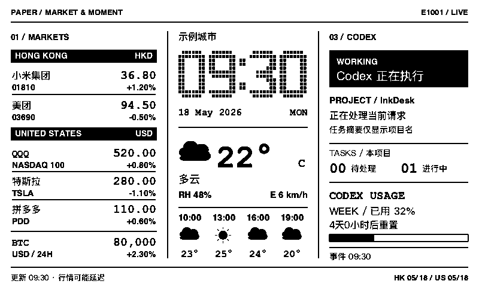

# InkDesk · 墨台

最近折腾了一个桌面小摆件，给它起名叫 InkDesk「墨台」。

想法很简单：把平时总要点开看的几件事，放到一块小屏幕上。车辆信息、天气、关注的行情，还有 Codex 有没有在干活、这周额度还剩多少，抬头就能看一眼。

尤其是把 AI 的工作状态摆到桌上这件事，我在这边坐着，它在旁边显示进度，多少有种看着同事上班的感觉 

用的是 reTerminal E1001，一块 800×480 的黑白墨水屏。除了实用信息，还放了一些老照片、书法和猫咪天气等，想看哪张就按一下。黑白屏和书法放在一起，还挺搭的。

有同款设备、喜欢折腾墨水屏的朋友可以一起玩。

**把关心的事，放在眼前。**

如果是你，会想在这块屏上放什么？

## 屏幕上有什么

用一台 Mac mini 采集数据、生成画面，E1001 通过局域网取图并显示。公开版共有五个页面。

| 页面 | 能看到什么 |
| --- | --- |
| 第 1 页 · 桌面看板 | 时间、日期、当地天气与逐小时预报，股票行情；接入 Codex 后还可看周额度和项目任务状态 |
| 第 2 页 · 车辆助手 | 续航、电量、充电状态、哨兵、总里程、最近停车时间、地点和车位 |
| 第 3 至第 5 页 · 离线图页 | 地平线、等高线、夜空三张黑白图，随固件保存在设备上 |

**实体按键**：左侧白键上一页，中间白键下一页，绿色键回首页。页面不会自动轮播。

### 页面预览

**车辆页** · 续航、充电状态和最近停车位置，图中为虚构数据。


**行情页（首页）** · 左侧看行情，中间看时间和天气，右侧看 Codex 工作状态和周额度。图中为虚构数据。



**书法页** · 自用设备上的《兰亭集序》。公开固件随附的离线图页为地平线、等高线和夜空。


## 第一步：选一台供数主机，在浏览器里看到首页

**没有 Mac mini，也可以用手边的 MacBook 或 iMac。** 在这台电脑上运行下面的 macOS 安装步骤，它就能承担相同的取数和渲染工作。只想体验首页时，直接在这台电脑上打开浏览器即可。要给实体屏持续供数，主机需要保持唤醒、运行墨台服务，并与 E1001 在局域网内互通；MacBook 合盖后如果进入睡眠，设备会保留已有画面，直到下次成功刷新。

在选好的主机上准备好 Git 和 [Homebrew](https://brew.sh/)。先用默认配置跑通首页；Codex、车辆账号和 E1001 都可以稍后接入。

**1. 下载项目，安装依赖。** 在终端中运行：

```sh
git clone https://github.com/alanwan0830-tech/InkDesk.git
cd InkDesk
brew install uv cairo
uv sync --locked --python 3.12
cp -n config.example.json config.json
```

`uv` 创建项目专用的 Python 3.12 环境，Cairo 用于渲染图片。`config.json` 是你自己的配置；上述复制命令会保留已有文件。

**2. 生成并查看首页。** 在同一个终端运行：

```sh
./run.sh --once
open runtime/dashboard.png
```

看到一张 800×480 的看板图，就说明本机渲染已跑通。默认天气城市是上海。个别数据源不可用时，仍可看到其他已取得的数据。

**3. 打开实时预览。**

```sh
./run.sh
```

保持终端运行，打开[本机实时看板](http://127.0.0.1:8766/)。预览页会显示首页图和各数据源状态。按 `Ctrl+C` 停止服务。只想在 Mac 上使用，到这里就可以了。

## 第二步：配置你关心的信息

### 更换天气城市

打开项目根目录的 `config.json`，修改 `weather.name`、`weather.latitude`、`weather.longitude` 三项，然后重启服务。例如，把城市改为杭州时，只需替换原有的 `weather` 对象：

```json
{"name": "杭州", "latitude": 30.2741, "longitude": 120.1551}
```

默认情况下，供数主机每 5 分钟采集行情和 Codex 额度，每 15 分钟采集天气。要调整采集间隔，修改 `config.json` 中的 `intervals.quotes`、`intervals.usage` 或 `intervals.weather`，单位为秒。设备取数周期由固件控制。

### 显示 Codex 额度和任务状态（可选）

周额度来自供数主机上已登录的 Codex 客户端。要在墨台上看到**当前项目的任务状态**，还需要在项目根目录运行一次：

```sh
.venv/bin/python integrations/configure-hooks.py
```

脚本会生成 `.codex/hooks.json`。在 Codex 中打开这个项目，检查并信任钩子，再执行一次任务即可验证。默认只显示当前项目的事件；钩子记录任务状态，不读取对话正文。

### 接入车辆助手（可选）

准备可访问的 EV Mate 服务、该服务签发的 API 密钥和车辆 ID。在供数主机上创建私有配置：

```sh
mkdir -p runtime
touch runtime/vehicle-config.json
chmod 600 runtime/vehicle-config.json
open -e runtime/vehicle-config.json
```

在文件中填入下面三个字段，用自己的值替换示例。远程服务使用 HTTPS；EV Mate 与墨台在同一台 Mac 上时，也可以使用 HTTP 回环地址。

```json
{
  "base_url": "https://example.invalid",
  "api_key": "REPLACE_WITH_YOUR_KEY",
  "vehicle_id": 1
}
```

`base_url` 填服务根地址，`vehicle_id` 填数字。车辆密钥只保存在供数主机上。接好实体屏后，从首页按中间白键验证：车辆页先显示缓存，取数成功后更新。停车记录单独查询，同一车辆最多每 15 分钟一次，结果在下一次车况刷新时显示。

## 第三步：接入 reTerminal E1001

如果你只用浏览器预览，可以跳过这一步。硬件路径适用于 **reTerminal E1001（ESP32-S3、32 MiB）**。供数主机需要在设备取数时保持唤醒，两者接入互通的可信局域网。

1. **开启设备接口。** 在 `config.json` 中保留 `device.transport` 为 `"local"`、`device.enabled` 为 `false`，将 `firmware_bridge.enabled` 改为 `true`。其中 `device.enabled` 控制旧版云端推送，局域网取图使用 `firmware_bridge.enabled`。
2. **配对并构建。** 按固件指南在供数主机上生成配对令牌，将同一个令牌、Wi-Fi 和供数主机的局域网地址填入本地固件配置。准备好令牌后重启墨台服务，再生成离线图页、编译固件。浏览器预览默认使用 `8766`，设备接口默认使用 `8767`。
3. **备份、预检、安装。** 先通过 USB 识别设备串口，备份这台设备的原厂固件，再执行只读预检。确认型号、分区和备份匹配后，才按指南将应用写入 app0。具体命令和支持范围见 [E1001 配对、构建与安装指南](firmware/README.md)。
4. **在屏上验证。** 启动后看首页能否取数、分钟时钟是否走动，再用按键切页并返回。有车辆配置时，进入第 2 页确认更新时间。设备诊断用的串口命令也在固件指南中。

## 日常使用与排查

| 想做什么或遇到什么 | 怎么处理 |
| --- | --- |
| 登录 Mac 后自动运行 | 先用默认端口 `8766` 验证前台服务，再按 `Ctrl+C` 退出，运行 `.venv/bin/python integrations/install-service.py`。后续查看 `runtime/service.log` |
| 浏览器打不开首页 | 先确认 `./run.sh` 仍在运行，并使用 `config.json` 中 `port` 对应的地址。若提示服务已运行，直接打开已有预览 |
| 首页正常，但设备没有新数据 | 确认供数主机已唤醒、设备能访问它的局域网地址、桥接接口已开启，且两端配对令牌一致。设备端使用供数主机的局域网地址，不能填 `127.0.0.1` |
| 车辆页显示更新失败 | 重新进入车辆页可立即重试。检查供数主机能否访问 EV Mate，以及车辆 ID 和密钥是否正确。已有缓存时保留上次车况和观测时间，首次取数失败则显示数据不可用 |

## 数据来源与项目资料

天气来自 [Open-Meteo](https://open-meteo.com/)，数据采用 [CC BY 4.0](https://creativecommons.org/licenses/by/4.0/)，免费 API 服务限非商业用途。行情来自 Yahoo Finance 和 Coinbase Exchange，可能存在延迟。使用或再分发前请核对各提供方条款。[Open-Meteo 服务条款](https://open-meteo.com/en/terms) · [第三方组件说明](THIRD-PARTY.md)

开发者可在项目根目录运行回归测试：

```sh
DYLD_FALLBACK_LIBRARY_PATH="$(brew --prefix cairo)/lib" .venv/bin/python -m pytest -q
```

查看[项目进度与验证范围](ROADMAP.md)。一般使用问题可在 [GitHub Issues](https://github.com/alanwan0830-tech/InkDesk/issues) 中反馈；涉及凭证或设备访问的问题请参阅[安全反馈说明](SECURITY.md)。
